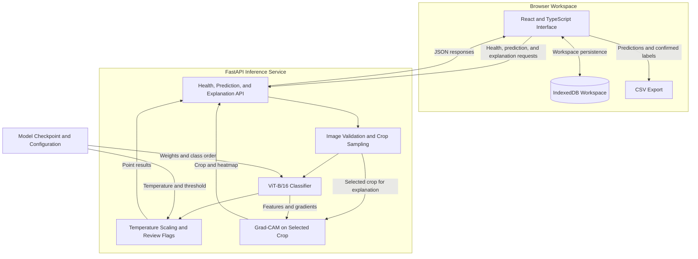

<div align="center">
  
  <h1>ReefEye</h1>
  <p><strong>A closer look beneath the surface.</strong></p>
  <p>Deep learning for coral reef image analysis, expert review, and survey management.</p>
  <p>
    <a href="#5-architecture">Architecture</a> ·
    <a href="#10-performance-metrics">Performance</a> ·
    <a href="#11-installation-and-setup">Installation</a> ·
    <a href="#17-explainable-ai">XAI</a> ·
    <a href="docs/MODEL_CARD.md">Model Card</a> ·
    <a href="https://github.com/Maram1alzahrani/ReefEye/releases/tag/model-v1">Model Weights</a>
  </p>
</div>

---

ReefEye brings reef photographs, model predictions, and human review into one workspace. It combines a Vision Transformer classifier with interactive image inspection, Grad-CAM explanations, confidence-based review, and structured survey records.

## Table of Contents

1. [Problem Statement](#1-problem-statement)
2. [System Overview](#2-system-overview)
3. [Implemented Features](#3-implemented-features)
4. [End-to-End Workflow](#4-end-to-end-workflow)
5. [Architecture](#5-architecture)
6. [Directory Structure](#6-directory-structure)
7. [Technology Stack](#7-technology-stack)
8. [AI Model Details](#8-ai-model-details)
9. [Dataset Information](#9-dataset-information)
10. [Performance Metrics](#10-performance-metrics)
11. [Installation and Setup](#11-installation-and-setup)
12. [Configuration](#12-configuration)
13. [Running the System](#13-running-the-system)
14. [Usage Guide](#14-usage-guide)
15. [Review and Export Pipeline](#15-review-and-export-pipeline)
16. [API Documentation](#16-api-documentation)
17. [Explainable AI](#17-explainable-ai)
18. [XAI Validation](#18-xai-validation)

## 1. Problem Statement

Reef image analysis involves more than assigning a label to a photograph. Reviewers need to inspect individual locations, understand the model's confidence, connect observations to a survey, and retain the original prediction when a label is corrected.

ReefEye addresses this workflow through point-level classification and human review. It organizes the path from a reef photograph to an inspectable, exportable survey record.

## 2. System Overview

ReefEye is a full-stack application with three connected layers:

| Layer | Responsibility |
| --- | --- |
| Survey workspace | Organize monitoring sites, surveys, photographs, and metadata. |
| Inference service | Sample image points, classify local crops, and return calibrated confidence scores. |
| Review and reporting | Inspect predictions, confirm labels, track review progress, and export results. |

The core workspace relationship is **Site → Survey → Photographs → Sampled Points → Review Decisions**.

The React frontend manages the workspace and visualization. The FastAPI backend runs the trained model. IndexedDB persists photographs, analysis results, and review decisions within the current browser and origin.

## 3. Implemented Features

| Feature | Implementation |
| --- | --- |
| Overview dashboard | Site, survey, analysis, and review summaries with class distribution charts. |
| Monitoring sites | Site records with optional latitude and longitude and an OpenStreetMap view. |
| Survey management | Survey records with date, depth, visibility, notes, and multiple photographs. |
| Image analysis | Sampling grids of 5 × 5, 7 × 7, and 10 × 10, supporting up to 25, 49, and 100 points. |
| Interactive predictions | Selectable image markers, point labels, class filters, confidence display, and crop inspection. |
| Confidence-based review | Automatic flags for predictions below the calibrated review threshold. |
| Human review | Confirm or correct labels, navigate pending points, and undo the latest review decision. |
| Explainable AI | On-demand Grad-CAM for individual point crops, with original/overlay views and adjustable opacity. |
| XAI diagnostics | Standalone model-randomization and patch-deletion tests with saved maps and JSON reports. |
| Coral directory | Browse supported classes using examples from analyzed workspace photographs. |
| CSV export | Export survey metadata, original predictions, confidence scores, and confirmed labels. |
| Workspace persistence | Browser-based storage of sites, surveys, images, and analysis state. |

## 4. End-to-End Workflow

| Stage | Action | Output |
| --- | --- | --- |
| 1. Register | Create a monitoring site and survey. | A survey record linked to its site. |
| 2. Upload | Add reef photographs and survey metadata. | A photograph collection within the survey. |
| 3. Analyze | Select a sampling grid and run analysis. | Point coordinates, predicted labels, confidence, and review flags. |
| 4. Inspect | Select points, examine their crops, and optionally generate Grad-CAM. | Image context and class-specific attribution for individual predictions. |
| 5. Review | Confirm the model label or select and confirm a correction. | A recorded human review decision. |
| 6. Export | Download image or survey results as CSV. | A table retaining original and confirmed labels. |

## 5. Architecture



### Component responsibilities

| Component | Role |
| --- | --- |
| React interface | Coordinates navigation, surveys, analysis requests, point inspection, and review actions. |
| IndexedDB | Stores workspace records, photograph blobs, predictions, and confirmed review labels. |
| FastAPI | Loads the model at startup and serves health, prediction, and explanation requests. |
| Image processing | Applies EXIF orientation, converts to RGB, and extracts normalized 224 × 224 crops. |
| PyTorch model | Executes ViT-B/16 inference on CPU in the application backend. |
| Confidence processing | Applies temperature-scaled softmax and flags scores below the review threshold. |
| Grad-CAM | Uses selected-class gradients and patch features from the trained ViT to generate crop-level attribution. |
| CSV export | Builds tabular reports in the browser from stored predictions and confirmed decisions. |

Site maps are displayed through an OpenStreetMap embed using the selected site's coordinates.

## 6. Directory Structure

| Path | Responsibility |
| --- | --- |
| `README.md` | Project overview, architecture, evaluation, and operating instructions. |
| `docs/MODEL_CARD.md` | Model configuration, label definitions, test results, and inference details. |
| `backend/main.py` | FastAPI application, model startup, image processing, prediction, and Grad-CAM explanations. |
| `backend/validate_xai.py` | Standalone randomization and deletion diagnostics using the shared Grad-CAM function. |
| `backend/requirements.txt` | Backend Python dependencies. |
| `backend/model/config.json` | Architecture, ordered labels, normalization, calibration, and experiment metadata. |
| `backend/model/reef_point_classifier.pt` | Trained checkpoint downloaded from the model release. |
| `frontend/src/App.tsx` | Workspace data, application views, analysis requests, review, and export logic. |
| `frontend/src/App.css` | Interface styling and responsive layouts. |
| `frontend/src/PointExplanation.tsx` | Point explanation requests, original/Grad-CAM views, and opacity controls. |
| `frontend/src/PointExplanation.css` | Explanation panel styling. |
| `frontend/src/main.tsx` | React application entry point. |
| `frontend/src/index.css` | Global base styles. |
| `frontend/public/` | Public branding and interface assets. |
| `frontend/src/assets/` | Bundled frontend assets. |
| `frontend/package.json` | Frontend dependencies and development commands. |
| `frontend/package-lock.json` | Locked frontend dependency versions. |
| `frontend/vite.config.ts` | Vite configuration. |

## 7. Technology Stack

| Area | Technologies |
| --- | --- |
| User interface | React, TypeScript, CSS |
| Frontend tooling | Vite, npm, Oxlint |
| Browser persistence | IndexedDB |
| Backend API | FastAPI, Uvicorn |
| Deep learning | PyTorch, torchvision |
| Image processing | Pillow, NumPy |
| Model development | scikit-learn, pandas, SciPy, Matplotlib, Hugging Face Datasets |
| Mapping | OpenStreetMap |

Model-development libraries support the training and evaluation workflow. Application runtime dependencies are defined in [backend/requirements.txt](backend/requirements.txt) and [frontend/package.json](frontend/package.json).

## 8. AI Model Details

### Model configuration

| Property | Value |
| --- | --- |
| Architecture | Vision Transformer, ViT-B/16 (`vit_b_16`) |
| Classification task | Semantic-mask-derived point crop classification |
| Input | 224 × 224 RGB crop centered on a sampled location |
| Output | Predicted label, calibrated confidence, and review flag |
| RGB normalization mean | `[0.485, 0.456, 0.406]` |
| RGB normalization standard deviation | `[0.229, 0.224, 0.225]` |
| Temperature | `1.7974332571029663` |
| Review threshold | `0.6782287788391114` — approximately 67.82% |
| Application inference | CPU, with batches of up to eight crops |
| Checkpoint | [ReefEye Model v1](https://github.com/Maram1alzahrani/ReefEye/releases/tag/model-v1), approximately 327 MiB |

### Supported labels

| Label | Category |
| --- | --- |
| Acropora | Coral genus |
| Background | Contextual class |
| Galaxea | Coral genus |
| Other Coral | Grouped coral class |
| Pocillopora | Coral genus |
| Porites | Coral genus |
| Stylophora | Coral genus |

### Model selection

Three architectures were compared using validation Macro F1: ResNet50, ConvNeXt Tiny, and ViT-B/16. **ViT-B/16 achieved the highest validation Macro F1 of 0.7487** and was selected for calibration, final testing, and application inference.

See the [Model Card](docs/MODEL_CARD.md) for the full inference pipeline and evaluation details.

## 9. Dataset Information

The released model uses [CoralscapesV2](https://huggingface.co/datasets/josauder/coralscapesV2), recorded as `josauder/coralscapesV2` in the model configuration.

The model-development workflow derives point labels from semantic masks and extracts image crops around sampled locations. Training and validation use per-class sampling within images; calibration uses uniformly sampled eligible points.

### Site-based split

| Partition | Dive sites | Point crops | Sampling |
| --- | ---: | ---: | --- |
| Training | 18 | 6,398 | Per-class sampling within images |
| Validation | 9 | 3,090 | Per-class sampling within images |
| Calibration | 8 | 2,544 | Uniform eligible-point sampling |
| Test — per-class view | 6 | 3,272 | Per-class sampling within images |
| Test — uniform view | 6 | 3,148 | Uniform eligible-point sampling |

The two test views evaluate the **same six held-out sites** with complementary sampling protocols. Training, validation, calibration, and test partitions use separate dive sites.

## 10. Performance Metrics

The following results come from the saved evaluation outputs for exported run `b03f3ddae1699f26`, matching the run identifier recorded in the application configuration.

### Classification results

| Metric | Per-class test view | Uniform test view |
| --- | ---: | ---: |
| Evaluated points | 3,272 | 3,148 |
| Accuracy | 77.72% | **84.82%** |
| Macro F1 | **0.7525** | 0.6493 |
| Weighted F1 | 0.7781 | **0.8668** |
| Balanced accuracy | 74.06% | 76.40% |

### Confidence calibration

Temperature scaling improved agreement between confidence and observed accuracy in both test views.

| Expected Calibration Error | Per-class test view | Uniform test view |
| --- | ---: | ---: |
| Before calibration | 0.1263 | 0.0744 |
| After calibration | **0.0362** | **0.0184** |

ECE is computed using 15 confidence bins; lower values indicate closer agreement.

### Confidence-guided review

On the uniform test view, predictions meeting the calibrated confidence threshold achieved **91.61% accuracy**, covering **81.4%** of evaluated points. The remaining **18.6%** were flagged for human review.

| Metric | Uniform test view |
| --- | ---: |
| Accuracy among above-threshold predictions | **91.61%** |
| Above-threshold coverage | **81.4%** |
| Points flagged for review | 18.6% |

The 91.61% result applies to the confidence-selected subset before manual correction. The 84.82% result describes overall accuracy across the uniform test view.

[View detailed test results](docs/MODEL_CARD.md#test-results).

## 11. Installation and Setup

### Prerequisites

| Requirement | Version or capability |
| --- | --- |
| Git | Repository cloning |
| Python | 3.11 |
| Node.js | 22.12+ or another version supported by Vite |
| npm | Included with Node.js |
| Browser | Modern browser with IndexedDB support |

### Clone the project

```bash
git clone https://github.com/Maram1alzahrani/ReefEye.git
cd ReefEye
```

### Download the checkpoint

From the repository root:

```bash
curl --fail --location --retry 3 \
  "https://github.com/Maram1alzahrani/ReefEye/releases/download/model-v1/reef_point_classifier.pt" \
  --output backend/model/reef_point_classifier.pt
```

The checkpoint can also be downloaded from the [release page](https://github.com/Maram1alzahrani/ReefEye/releases/tag/model-v1) and placed at `backend/model/reef_point_classifier.pt`.

<details>
<summary>Checkpoint integrity verification</summary>

Expected SHA-256:

```text
d865da5662ecd676904e46cdfb0f8e211c24e8bcb8384c2b31e83754a42a0319
```

On macOS:

```bash
shasum -a 256 backend/model/reef_point_classifier.pt
```

</details>

### Install backend dependencies

From the repository root:

```bash
cd backend
python3 -m venv .venv
source .venv/bin/activate
python -m pip install -r requirements.txt
```

On Windows, create the environment with `py -3.11 -m venv .venv`. Activate it with `.venv\Scripts\activate.bat` in Command Prompt or `.\.venv\Scripts\Activate.ps1` in PowerShell.

### Install frontend dependencies

In a separate terminal, from the repository root:

```bash
cd frontend
npm ci
```

## 12. Configuration

The local application uses source and model configuration files:

| Setting | Location | Current configuration |
| --- | --- | --- |
| Frontend API address | `API` constant in `frontend/src/App.tsx` | `http://127.0.0.1:8000` |
| Model directory | `MODEL_DIR` in `backend/main.py` | `backend/model/` |
| Model and preprocessing settings | `backend/model/config.json` | Architecture, class order, crop size, normalization, temperature, and threshold |
| Allowed frontend origins | CORS middleware in `backend/main.py` | HTTP localhost and 127.0.0.1 origins |
| Backend port | Uvicorn launch command | `8000` |

The current local setup uses these values directly. For hosted deployment, configure the frontend API address and permitted frontend origin for the deployed services.

At startup, the backend verifies the checkpoint's architecture and ordered class list against `config.json`.

## 13. Running the System

### Terminal 1 — inference backend

From the repository root, after installation:

```bash
cd backend
source .venv/bin/activate
python -m uvicorn main:app --reload --port 8000
```

Wait for `Application startup complete`.

| URL | Purpose |
| --- | --- |
| [http://127.0.0.1:8000/health](http://127.0.0.1:8000/health) | Model readiness, architecture, and classes |
| [http://127.0.0.1:8000/docs](http://127.0.0.1:8000/docs) | Interactive API documentation |

The health endpoint returns `"status": "ready"` when startup completes.

### Terminal 2 — frontend

From the repository root:

```bash
cd frontend
npm run dev
```

Open the local URL printed by Vite and keep both processes running.

### Build and preview the frontend

From `frontend/`:

```bash
npm run build
npm run preview
```

The frontend build is generated in `frontend/dist/`. Keep the backend running when using the preview for image analysis.

## 14. Usage Guide

### Create a survey workspace

1. Open **Monitoring Sites** and add a site.
2. Enter optional site coordinates to enable its map view.
3. Open **Surveys** and create a survey linked to that site.
4. Add the survey date, optional depth, visibility, and notes.
5. Upload one or more reef photographs.

### Analyze and inspect

1. Open a photograph in **AI Analysis**.
2. Select a sampling grid.
3. Run analysis and select a point on the image.
4. Inspect its crop, predicted label, and calibrated confidence.
5. Use class and review filters to focus the displayed points.
6. Select **Explain prediction** in the point inspector to generate Grad-CAM.
7. Switch between **Original** and **Grad-CAM**, and adjust **Heatmap opacity**.

### Confirm review decisions

1. Open **Human Review** or select a point in the analysis view.
2. Inspect the crop and choose a review label.
3. Confirm the label to record the decision.
4. Continue through pending points or undo the latest decision.
5. Export image or survey results from the workspace.

## 15. Review and Export Pipeline

ReefEye preserves the original model output alongside the review decision.

| Status | Meaning |
| --- | --- |
| `Model prediction` | An unreviewed prediction meeting the confidence threshold. |
| `Needs review` | A below-threshold prediction awaiting human confirmation. |
| `Reviewed` | A label explicitly confirmed by the reviewer. |

When a point is confirmed, its current label and review status are updated. The original prediction and model confidence remain available in the export.

### CSV contents

| Group | Exported fields |
| --- | --- |
| Site | `site`, `latitude`, `longitude` |
| Survey | `survey`, `survey_date`, `depth_m`, `visibility_m` |
| Image and location | `image`, `point`, `row`, `column` |
| Original model output | `model_prediction`, `model_confidence`, `model_needs_review`, `review_threshold` |
| Current review state | `current_label`, `review_status` |

The current label reflects the confirmed decision when one exists; otherwise, it retains the model prediction. Draft selections are applied to exported labels after confirmation.

CSV generation runs in the browser. Workspace records and photograph blobs are persisted through IndexedDB.

## 16. API Documentation

The backend provides interactive documentation at [http://127.0.0.1:8000/docs](http://127.0.0.1:8000/docs).

### Endpoints

| Method | Endpoint | Description |
| --- | --- | --- |
| `GET` | `/health` | Return readiness status, architecture, and supported classes. |
| `POST` | `/predict` | Analyze sampled points in an uploaded reef image. |
| `POST` | `/explain` | Generate Grad-CAM for a specified point crop and target class. |

### Prediction request

`POST /predict` accepts multipart form data:

| Field | Type | Configuration |
| --- | --- | --- |
| `file` | Image file | Required; readable by Pillow |
| `grid_size` | Integer | Default 5; accepted values 2–10 |

Image requirements: minimum 224 × 224 pixels, maximum 20 MiB, and maximum 25 megapixels. The interface offers grid sizes 5, 7, and 10.

Example request, with `reef-photo.jpg` replaced by a local image path:

```bash
curl --fail --request POST http://127.0.0.1:8000/predict \
  --form "file=@reef-photo.jpg" \
  --form "grid_size=5"
```

### Prediction response

| Response field | Contents |
| --- | --- |
| `filename`, `width`, `height` | Uploaded filename and EXIF-corrected image dimensions |
| `classes` | Ordered model label list |
| `points` | Point identifier, pixel row and column, prediction, confidence, review flag, and status |
| `total_points` | Number of sampled locations |
| `review_count`, `review_rate` | Number and share of points flagged for review |
| `review_threshold` | Calibrated confidence threshold |

Coordinates use `(row, column) = (y, x)` in the EXIF-corrected image. Images are processed in memory by the inference service.


### Explanation request

`POST /explain` accepts multipart form data:

| Field | Type | Configuration |
| --- | --- | --- |
| `file` | Image file | Required; use the photograph analyzed by `/predict`. |
| `row` | Integer | Pixel y-coordinate in the EXIF-corrected image. |
| `column` | Integer | Pixel x-coordinate in the EXIF-corrected image. |
| `target_label` | String | Exact model label, such as `acropora`; the interface uses the point's original prediction. |

The point must allow a complete 224 × 224 crop within the image. Use coordinates and the label returned by `/predict`. This example targets a crop centered at `(112, 112)`:

```bash
curl --fail --request POST http://127.0.0.1:8000/explain \
  --form "file=@reef-photo.jpg" \
  --form "row=112" \
  --form "column=112" \
  --form "target_label=acropora"
```

### Explanation response

| Response field | Contents |
| --- | --- |
| `method`, `target_layer` | `Grad-CAM` and `encoder.layers[-1].ln_1` |
| `row`, `column`, `target_label` | Requested coordinates and explained class |
| `target_confidence` | Temperature-scaled probability of the requested class |
| `prediction` | Current model's highest-probability class for the crop |
| `has_signal` | Whether a nonzero positive attribution map was obtained |
| `crop_image` | Original RGB crop as a base64 PNG data URL |
| `heatmap_image` | Transparent RGBA heatmap as a PNG data URL, or `null` when no positive signal exists |

## 17. Explainable AI

ReefEye provides **class-specific Grad-CAM explanations** for individual sampled points. It reuses the released ViT checkpoint; no additional model download or retraining is required.

### How the explanation is generated

1. Extract the same normalized 224 × 224 crop used for point classification.
2. Capture features at `model.encoder.layers[-1].ln_1`, before the final attention block.
3. Differentiate the requested class logit with respect to those features.
4. Exclude the class token and combine the spatial patch features using gradient-derived channel weights.
5. Retain positive contributions, interpolate to crop resolution, and normalize the map for display.

The overlay uses warmer colors for stronger positive attribution to the target class score. Each map is normalized separately, so its color intensity describes relative attribution within that crop. The displayed percentage is the target class's calibrated confidence.

### Using the explanation panel

After analyzing a photograph, select a point and click **Explain prediction**. Use **Original** and **Grad-CAM** to compare the views, **Heatmap opacity** to adjust the overlay, and **Regenerate explanation** to request it again.

Explanations target the original model label. Confirmed human labels remain separate, and generating an explanation does not update model weights or review decisions. If no positive activation is obtained, the panel reports that state instead of displaying a generated heatmap.

Grad-CAM visualizes model attribution rather than coral segmentation boundaries. Quantitative checks are available through the validation script below.

## 18. XAI Validation

[`backend/validate_xai.py`](backend/validate_xai.py) evaluates the same `gradcam` function used by the API. It runs directly on the local checkpoint and configuration, independently of the web server. Backend dependencies from Section 11 are sufficient.

### Diagnostic protocol

| Check | Procedure | Recorded evidence |
| --- | --- | --- |
| Model randomization | Compare the trained map with maps from fully reinitialized ViT models using seeds 11, 22, and 33. Keep the crop and trained model's predicted target class fixed. | Patch-level Pearson correlation, mean absolute map difference, and near-identical-map counts. |
| Patch deletion | Progressively replace approximately 10%, 20%, 30%, and 50% of patches, starting from the original input at 0%. Compare hot-first, cold-first, and repeated random deletion. | Target-class confidence curves, confidence drops, and partial area under each curve. |
| Replacement baseline | Use the configured normalization mean or a Gaussian-blurred version of the crop for every deletion order. | Separate reports for each baseline. |

The random models use a nonzero randomly initialized classification head so gradients can propagate. No model is trained during these diagnostics. Missing or constant maps are recorded as inconclusive comparisons.

### Run on one image

From the repository root, activate the backend environment:

```bash
cd backend
source .venv/bin/activate
```

Replace the example path with an existing image:

```bash
python validate_xai.py "/path/to/reef-photo.jpg"
```

The default selects one crop at the image center. To inspect a specific analyzed location, supply its coordinates from `/predict` or the CSV export:

```bash
python validate_xai.py "/path/to/reef-photo.jpg" \
  --row 500 \
  --column 700
```

Coordinates refer to the EXIF-corrected image and must permit a complete crop. The script explains the current trained model's predicted class at that location.

### Run on a collection of images

Use a representative collection of held-out photographs. Folder mode selects one center crop per image, processes supported files in sorted order, and stops at `--max-images`.

```bash
python validate_xai.py "/path/to/test-images" \
  --max-images 20 \
  --random-trials 10 \
  --baseline mean \
  --output xai_validation_mean
```

Repeat with the same images and a blurred replacement baseline:

```bash
python validate_xai.py "/path/to/test-images" \
  --max-images 20 \
  --random-trials 10 \
  --baseline blur \
  --output xai_validation_blur
```

### Command options

| Argument | Default | Purpose |
| --- | --- | --- |
| `images` | Required | Image file or folder; folders support JPG, JPEG, PNG, and WebP. |
| `--row`, `--column` | Image center | Supply both for a single image to select a specific point. |
| `--max-images` | `5` | Maximum images processed in folder mode. |
| `--seeds` | `11 22 33` | Random-model initialization seeds. |
| `--random-trials` | `5` | Random deletion orders per crop; minimum 2. |
| `--baseline` | `mean` | Replacement policy: `mean` or `blur`. |
| `--output` | `xai_validation` | Destination folder for reports and images. |

### Saved outputs

| Output | Contents |
| --- | --- |
| `report.json` | Protocol settings, aggregate summary, per-crop randomization metrics, and deletion curves. |
| `001_<image-stem>/crop.png` | Evaluated crop; each image has its own numbered folder. |
| `trained_cam.png` | Normalized trained-model attribution, saved as grayscale when a signal exists. |
| `random_cam_<seed>.png` | Normalized attribution from each randomized model when a signal exists. |

### Reading the results

| Metric | Interpretation |
| --- | --- |
| `mean_pearson` | Average correlation between trained and randomized patch-level maps. Values close to 1 indicate similar spatial patterns. |
| `mean_absolute_difference` | Per-comparison absolute difference between normalized patch-level maps. |
| `nearly_identical_comparisons` | Comparisons equal within absolute tolerance `1e-5`; these warrant inspection. |
| `inconclusive_comparisons` | Comparisons excluded because a map was absent or spatially constant. |
| `hot_drop_percentage_points` | Reduction in the original target's confidence at each hot-first deletion fraction; negative values indicate an increase. |
| `random_drop_percentage_points` | Corresponding reduction for the mean random-deletion curve. |
| `hot_partial_auc`, `cold_partial_auc`, `random_mean_partial_auc` | Average target probability over the tested deletion range, approximately 0–50%. Lower values mean less confidence retained. |
| `random_minus_hot_partial_auc` | Positive values mean hot-first deletion retained less confidence on average than random deletion. |
| `mean_random_minus_hot_partial_auc` | Mean of that difference across crops with a trained-model attribution map. |

Inspect per-crop curves and random-trial variation alongside aggregate values. Evidence supporting the explanation includes sensitivity to model randomization and a greater confidence reduction under hot-first deletion than under random or cold-first deletion across representative crops and both replacement baselines. These are diagnostic measurements, with no universal pass threshold or automatic validity claim.


---

**Additional documentation:** [Model Card](docs/MODEL_CARD.md) · [Model Release](https://github.com/Maram1alzahrani/ReefEye/releases/tag/model-v1)

[Back to Table of Contents](#table-of-contents)
